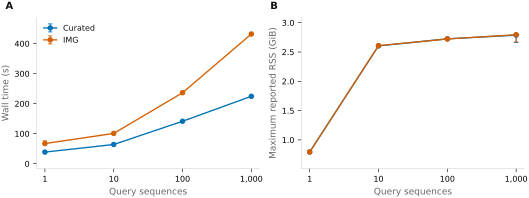

# Runtime and memory by input size

These measurements use SSUextract 1.3.0 with database v1.0.2 and Nextflow
25.10.4 on one compute node of the Dori cluster. The search step is
`blastn -task blastn` with up to 501 subjects per query.

The benchmark uses nested subsets of the bundled assemblies containing 1, 10,
100, or 1,000 query sequences. Each subset was run through the complete
SSUextract workflow with both database profiles.

| Query sequences | Input nucleotides | Accepted loci | Curated wall time | Curated maximum RSS | IMG wall time | IMG maximum RSS |
| ---: | ---: | ---: | ---: | ---: | ---: | ---: |
| 1 | 113,952 | 1 | 38.69 s | 0.795 GiB | 67.21 s | 0.794 GiB |
| 10 | 771,608 | 2 | 64.01 s | 2.605 GiB | 100.90 s | 2.608 GiB |
| 100 | 3,846,999 | 4 | 141.44 s | 2.725 GiB | 236.38 s | 2.722 GiB |
| 1,000 | 13,254,565 | 10 | 224.60 s | 2.788 GiB | 431.91 s | 2.795 GiB |

Values in the table are medians from three measured runs. The bars in both
panels show the minimum and maximum measured values.

## Benchmark conditions

- One warm-up run preceded the three measured runs for each condition.
- Every run used a fresh Nextflow work directory and its own launch directory.
- Search tasks used two threads, with an eight-CPU workflow ceiling.
- The same input subset was used for both database profiles.
- Every run produced at least one accepted locus and identical extracted
  sequences, summary tables, and BLAST output within its condition.

GNU `time` wrapped the full `nextflow run` command. Its maximum RSS is the
largest value reported for that command, not a sum across concurrent workflow
processes. The wall time includes the checksum of the database files that
Nextflow computes when a run starts. Runtime and memory vary with sequence
length, hit count, storage, and available CPUs.

The 32 trial records, including warm-ups, input hashes, nucleotide counts, and
accepted-locus counts, are available in
[`example_performance.tsv`](../data/example_performance.tsv). The figure and
summary table are generated by `notebooks/example_performance.ipynb`.
